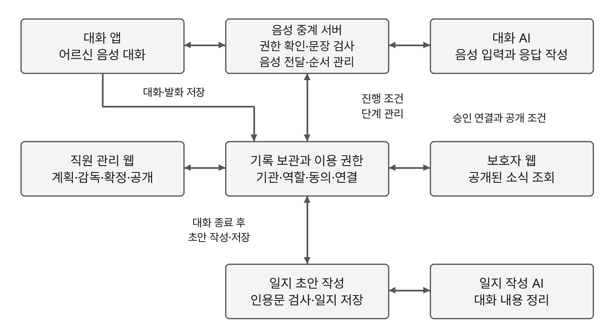
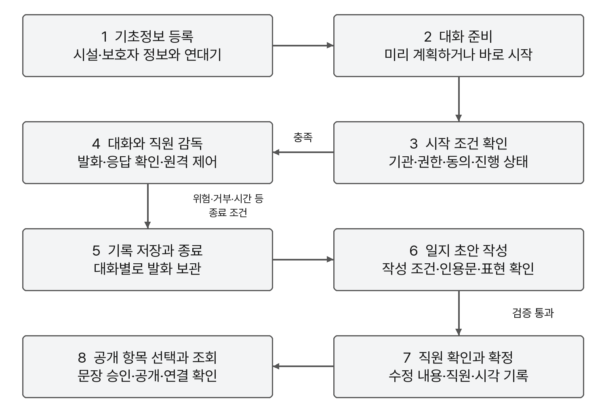
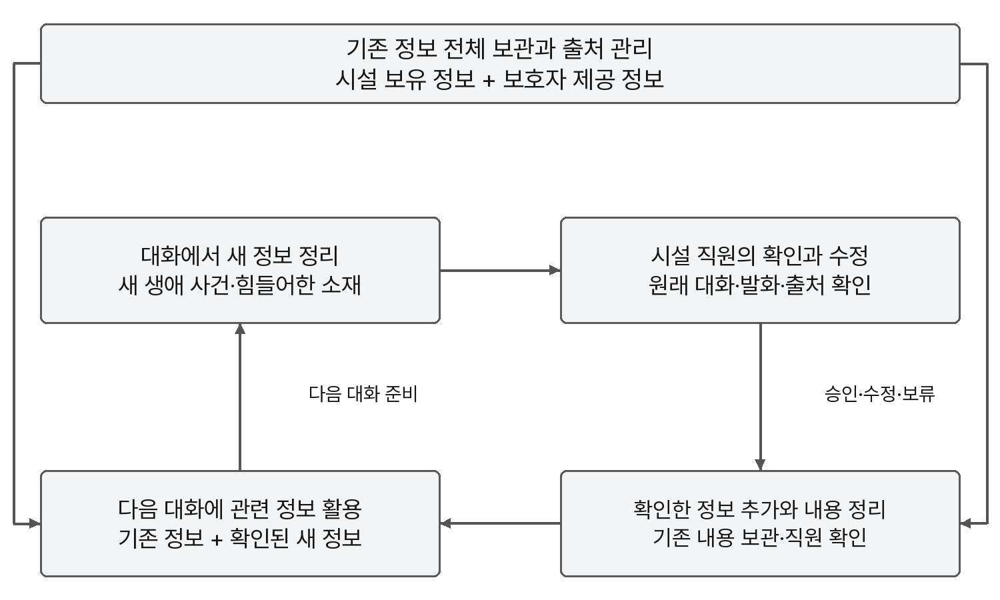

# 회상 대화와 활동 기록 관리 시스템 특허 검토자료

2026년 11월 19일

## 1 발명의 개요

시설과 보호자가 제공한 어르신 정보를 바탕으로 회상 대화를 진행하고, 대화 내용을 프로그램 일지 초안으로 작성하는 시스템입니다. 직원이 일지를 확인하고 확정한 뒤 보호자에게 전할 내용을 선택합니다. 향후에는 대화에서 새로 알게 된 생애 사건과 힘들어한 소재를 직원이 확인하여 기존 정보에 더하고, 다음 대화를 준비할 때 활용할 계획입니다.

발명의 가칭은 **회상 대화 기반 활동 기록 작성 및 공유 시스템과 그 운영 방법**입니다. 대화 준비부터 진행, 안전 관리, 일지 작성, 직원 확인, 보호자 공개, 다음 대화 준비까지 이어지는 절차를 설명합니다.

### 해결하려는 문제와 목적

직원은 대화를 마친 뒤 활동 내용을 기록하고 보호자에게 전할 이야기를 정리합니다. 이 과정에서 대화 내용을 다시 옮겨 적고 사실관계를 확인하는 시간이 듭니다. AI로 일지 초안을 작성할 때에도 원래 발화와의 일치 여부, 확인한 직원, 보호자에게 공개할 범위를 관리해야 합니다. 기존 기록과 새 대화 내용이 서로 다를 때 이를 확인하고 정리하는 절차도 필요합니다.

이 시스템은 대화 기록을 일지와 보호자용 소식으로 정리해 직원의 작성 부담을 줄이고, 원래 발화를 참고해 내용을 확인하도록 돕는 것을 목적으로 합니다. 대화 중 위험 신호를 감지하면 직원에게 알리고, 확인한 개인 정보를 다음 대화에 활용하도록 설계합니다. 이 가운데 특허의 중심으로 삼을 기술은 선행기술과 비교하여 검토받고자 합니다.

### 참여자와 역할

| 참여자 | 주요 역할 |
|---|---|
| 어르신 | 휴대전화나 태블릿으로 회상 대화에 참여합니다. 대화 중 쉬고 싶거나 그만하고 싶다는 의사를 표현할 수 있습니다. |
| 진행 직원 | 어르신 정보와 대화 계획을 등록하고 진행 상황을 감독합니다. 담당 권한에 따라 일지와 새로 수집한 정보를 확인합니다. |
| 기관 관리자 | 직원의 역할과 업무 권한을 관리합니다. 일지 확정, 보호자 연결 승인, 공개 관리 등을 담당할 직원을 정합니다. |
| 보호자 | 어르신의 생애와 생활에 관한 정보를 제공합니다. 연결 승인을 받은 후 공개된 소식을 보고 직원과 소통합니다. |

### 현재 기능과 향후 개발 계획

현재는 대화 앱, 직원·보호자 웹, 음성 중계, 일지 초안 작성과 직원 확인, 보호자 선택 공개 기능을 갖추고 있습니다. 대화에서 새로 얻은 정보를 직원이 확인해 다음 대화에 반영하는 기능, 발화의 의미와 음성 특징을 살피는 기능, 대화 모델을 학습시키는 기능은 향후 개발 계획입니다. 요양원과 주간보호기관의 일상적인 회상 활동과 기록 업무에 적용합니다.

<!-- page -->

## 2 시스템 구성과 데이터

어르신은 휴대전화나 태블릿의 앱으로 대화합니다. 직원은 웹에서 어르신 정보를 입력하고 대화를 계획하며, 진행 상황과 일지를 확인합니다. 보호자는 보호자용 웹에서 공개된 소식을 읽고 직원과 소통합니다. 서버는 대화 이용 권한을 확인하고 음성 전달과 일지 작성을 처리합니다.

도면 1은 앱, 웹, 서버와 AI 사이의 정보 전달 경로를 나타냅니다. 어르신에게 들려주는 음성은 서버의 문장 검사를 통과한 텍스트를 합성해 만듭니다. 대화는 앱에서 진행하고, 직원은 웹에서 감독합니다.

| 데이터 | 연결 기준과 관리 내용 |
|---|---|
| 기본정보와 연대기 | 어르신별로 기본정보, 생애 사건, 회상 소재를 보관합니다. |
| 대화 계획과 진행 상태 | 소속 기관, 대상 어르신, 계획한 직원, 실제 진행 직원, 목표 시간과 현재 단계를 기록합니다. |
| 발화와 작성 문장 | 발화자와 발화 식별번호, 음성을 글로 옮긴 출처를 기록합니다. 일지 작성 과정에서 인용문을 대조합니다. |
| 일지와 공개 정보 | 일지의 작성·확정 상태와 확인 직원을 기록합니다. 보호자 문장의 승인과 공개·철회 이력도 관리합니다. |
| 안전과 감독 기록 | 위험 신호와 관련 발화, 담당자 확인, 직원의 대화 중 개입을 기록합니다. |
| 향후 어르신 정보 | 기존 정보와 새로 얻은 정보의 출처, 직원 확인 여부, 대화에 사용할 범위를 관리합니다. |

서버는 이용자의 소속 기관과 역할, 동의 여부, 보호자 연결과 공개 상태를 확인합니다. 기관 직원은 업무 권한에 따라 기록을 이용하고, 보호자는 연결된 어르신의 공개 자료를 조회합니다. 담당 직원 정보는 알림 수신자와 담당 어르신 목록을 정하는 데 사용합니다.

<!-- page -->

## 3 전체 처리 흐름

직원은 미리 계획한 대화를 선택하거나 바로 대화를 시작합니다. 미리 계획한 경우 목표, 이야기할 소재, 주요 단어, 피할 주제와 시간을 반영합니다. 바로 시작하는 경우에는 등록된 어르신 정보와 기본 대화 지침을 사용합니다. 서버가 이용 권한과 동의, 실행 상태를 확인한 후 대화를 연결합니다.

대화는 도입, 회상, 마무리 순서로 진행하며 서버가 현재 단계와 시간을 관리합니다. 현재 시범 운영 설정은 한 번에 최대 10분, 직원 1명당 동시 최대 4대, 어르신 1명당 진행 중인 대화 1개입니다. 이용 권한, 동의, 동시 실행 수 등의 조건을 충족하면 대화를 시작합니다.

대화가 끝나면 일지 초안 작성 작업을 자동으로 등록합니다. 발화 저장이 늦어지거나 초안 작성에 오류가 생기면 재시도 상태를 기록하고 다시 처리합니다. 직원은 결과와 처리 상태를 확인할 수 있습니다. 기관은 운영 방식에 따라 AI 초안 작성 또는 직원 직접 작성을 선택합니다.

직원이 일지를 확정한 뒤 보호자에게 전할 문장을 승인하고 공개할 항목을 고릅니다. 서버는 보호자 연결과 공개 상태를 확인해 해당 자료를 제공합니다. 향후에는 대화에서 새로 얻은 정보도 직원이 확인하고, 다음 대화의 준비 자료에 반영할 계획입니다.

<!-- page -->

## 4 대화 중 안전 관리와 일지 확정

### 어르신 발화와 AI 응답 확인

음성 중계 서버는 어르신의 음성을 글로 옮긴 결과를 받아 위험, 고통, 휴식 요청, 거부 의사를 검사합니다. 위기나 급성 고통을 감지하면 대화 연결을 즉시 종료하고 관련 내용을 기록해 직원에게 알립니다. 휴식 요청이나 거부 의사에는 정해진 마무리 인사를 들려준 뒤 대화를 마칩니다.

AI 응답은 문장 검사를 통과한 후 음성으로 합성합니다. 중계 서버는 합성 음성의 형식, 크기, 순서와 이용 권한, 대화 상태를 확인해 앱으로 보냅니다. 위기 대응과 응답 검사, 의료적 진단 표현에 관한 안전 규칙은 모든 기관에 공통으로 적용합니다.

### 음성 재생과 다음 발화의 순서 관리

서버와 앱은 응답 작성, AI 측의 응답 처리 종료, 음성 전달, 앱의 재생 완료와 중단을 각각 관리합니다. 검사한 응답을 음성으로 합성하면서 순서대로 보내고, 앱은 전체 음성의 수신과 재생이 끝나면 완료 결과를 서버에 보냅니다. 재생 중 어르신이 말하면 음성을 멈추고 중단 결과를 보냅니다. 각 대화 차례에 식별번호를 붙여 늦게 도착한 응답과 다음 발화를 구분합니다.

현재 서버는 앱이 보고한 재생 완료와 중단 결과를 처리합니다. 이 결과를 장기간 보관하는 저장 기능은 추가 개발 항목입니다.

### 원래 발화를 참고한 일지 작성

일지 작성 서버는 저장된 대화를 읽고 요약, 진행 내용, 참여자 반응 등을 정리합니다. 작성 문장에 어르신 발화의 식별번호와 인용문을 붙이도록 하고, 인용문이 해당 발화에 들어 있는지 검사합니다. 표현 검사까지 마친 문장은 일지의 해당 칸에 저장합니다. 외부 AI에 대화를 보내기 직전과 결과를 저장하기 직전에 동의와 이용 조건을 다시 확인합니다.

직원은 원래 발화와 초안을 대조해 내용과 의미를 확인합니다. 현재는 검사를 마친 문장을 일지에 저장하며, 문장 옆에서 근거 발화를 바로 확인하는 기능은 추가 개발 항목입니다. 보호자용 문장에는 글자 수와 진단 표현 등의 검사를 적용합니다.

### 직원의 일지 확정과 보호자 공개

자동 작성 프로그램은 일지 초안을 확인 대기 상태로 저장합니다. 일지 확정 권한은 인증된 직원 계정에 부여하며, 수정하고 확정한 직원과 그 시각을 남깁니다. 실제 진행 직원과 AI 도구 사용 내역은 별도 항목에 기록합니다. 종합평가와 다음 계획은 직원이 작성합니다.

직원이 보호자용 문장을 승인하고 공개 항목을 선택하면, 연결 승인을 받은 보호자가 해당 자료를 볼 수 있습니다. 공개를 철회하면 서버가 이후 조회 권한을 회수합니다.

<!-- page -->

## 5 어르신 정보의 확인과 다음 대화 반영

향후에는 시설이 보유한 정보와 보호자가 제공한 정보를 전체 보관하고, 대화 주제나 발화에 관련된 내용을 찾아 사용할 계획입니다. 대화에서 새로 알게 된 생애 사건과 힘들어한 소재는 시설 직원이 확인하고 수정한 뒤 다음 대화에 반영합니다.

시설과 보호자의 기존 정보에는 각각 출처를 기록합니다. 새로 정리한 정보에는 어느 대화에서 나온 내용인지, 어떤 발화에 근거하는지, 언제 정리했는지를 남기고 확인 대기 상태로 둡니다. 직원은 내용을 확인해 승인하거나 수정·보류합니다. 승인한 내용은 다음 대화의 참고 정보에 더합니다.

시설 정보, 보호자 정보, 새 대화 내용이 서로 다르면 원래 정보를 보존하고 직원 확인 대상으로 표시합니다. 직원은 각 내용의 출처를 살펴 정리합니다. 어르신과의 대화에서는 이야기를 존중하고, 기록의 차이는 직원용 관리 화면에서 확인합니다.

다음 대화를 준비할 때에는 사용 가능한 정보 중 관련 내용을 찾아 직원의 당일 지침과 함께 반영합니다. 힘들어한 소재는 주제 선택과 전환에 참고하며, 현재 어르신의 의사와 안전 규칙을 함께 적용합니다. 정보 수정과 사용 철회, 이후 대화 반응을 기록하는 방법은 후속 설계에서 정합니다.

현재 AI에 전달하는 대화 지침에는 기본정보와 연대기 중 상위 10개 항목을 사용합니다. 전체 정보에서 관련 내용을 찾고 새 정보를 확인해 더하는 절차는 향후 개발 계획입니다. 검색 방법, 새 정보의 정리 기준, 직원 확인 화면과 정보 갱신 주기를 구체화할 예정입니다.

<!-- page -->

## 6 향후 개발 구상

### 발화 내용과 목소리를 살펴 직원에게 알림

기존의 위험 표현 검사에 발화의 맥락과 음성 특징을 더할 계획입니다. 누가 언제 겪은 일인지, 다른 사람의 말을 인용하는지, 어떤 의사로 말하는지를 살피고 말의 속도와 음량, 침묵 길이를 함께 참고합니다. 분석에 사용할 음성 구간을 고를 때에는 음질과 화자, 소음·에코 상태를 확인합니다.

음성에서 측정한 값, AI가 추정한 감정, 어르신의 계속·휴식 의사, 직원의 관찰과 조치를 각각 기록합니다. 평소 목소리와 비교할 자료가 얼마나 쌓였는지도 함께 표시합니다. 감정 분석 결과는 직원이 대화 상황을 살피는 참고 자료로 제공합니다.

응답 문장은 기존 안전 규칙과 문장 분류 검사를 거쳐 재생하고, 음성의 감정 분석은 이와 병행합니다. 직원 확인이 필요한 상황으로 판단하면 대화를 일시정지하고 관련 발화와 판단 자료를 보여 줍니다. 일시정지 동안에는 녹음과 음성 수집을 중단하고, 직원이 재개하면 새 연결에 이전 대화 내용을 전달합니다. 명확한 위기와 급성 고통에는 현재의 즉시 종료 규칙을 우선 적용합니다.

감정 분류 항목, 판단 기준, 직원의 응답 대기시간과 재개 조건은 후속 설계에서 정합니다.

### 기간별 관찰 자료의 제공

같은 어르신의 대화 기록을 기간별로 모아 직원이 참여 양상과 이야기한 소재를 살펴보도록 정리하는 방안입니다. 대화 횟수, 자료량, 기록 출처와 수집 조건을 함께 표시하고, 관찰한 내용과 AI 추정, 직원 의견을 나눠 보여 줍니다. 보호자용 소식은 직원이 내용을 확인하고 공개 범위를 선택해 제공합니다.

### 어르신 대화에 맞춘 음성 인식과 대화 모델 학습

장기적으로는 학습에 사용할 권한과 출처, 동의 범위를 확인한 자료를 모으고, 사람이 음성과 대화 내용을 검수하여 음성 인식과 대화 모델을 각각 학습시킬 계획입니다. 학습 자료와 모델의 버전, 평가 결과를 기록하고 검증을 마친 기능부터 서비스에 적용합니다. 학습 참여 동의와 외부 AI 자료의 사용 조건은 별도 절차로 확인합니다.

### 다른 단말과 연대기 콘텐츠

로봇, 인형, 전용 기기에 마이크와 스피커, 화면을 갖추고 같은 서버를 이용하는 형태도 검토할 수 있습니다. 기기가 달라져도 대화 이용 권한, 문장 검사, 일지 작성과 직원 확인 절차를 함께 적용하는 구상입니다. 구체적인 기기 구성은 후속 설계에서 정합니다.

회상 내용을 연대기 동화책으로 만드는 방안은 별도 검토 항목으로 두었습니다. 수집한 이야기의 구성, 삽화 제작, 내용 확인과 출판 절차를 정리해 검토할 계획입니다.

<!-- page -->

## 7 주요 기술과 특허 검토 요청

다음 기술들이 하나의 업무 과정에서 이어지는 방식에 대해 선행기술과 비교한 검토를 요청드립니다.

| 주요 기술 | 처리 순서 |
|---|---|
| 대화 내용으로 일지 작성 | 어르신 정보와 대화 계획 → 발화 저장 → 인용문 검사 → 일지 초안 작성 |
| 직원 확인과 보호자 공개 | 확인 대기 → 직원 확정 → 보호자 문장 승인 → 항목 선택 → 보호자 조회 |
| 문장 검사 후 음성 재생 | 응답 문장 검사 → 음성 합성 → 형식과 순서 확인 → 앱 재생 |
| 대화와 재생 순서 | 응답 작성·전달·재생 결과 기록 → 늦게 도착한 응답 확인 → 다음 발화 처리 |
| 위험 감지와 직원 알림 | 어르신 발화 검사 → 대화 종료와 사건 기록 → 감독 화면과 담당자 알림 |
| 향후 어르신 정보 반영 | 기존 정보와 새 정보 → 직원 확인과 정정 → 관련 내용 검색 → 다음 대화 |
| 향후 목소리 분석 | 음질 확인 → 음성 분석과 본인 의사 확인 → 일시정지 → 직원 확인과 조치 기록 |

### 기대 효과와 검증 방향

대화 내용을 다시 옮겨 적고 정리하는 시간을 줄이며, 직원이 초안을 확인하고 공개할 내용을 고르는 데 도움을 주는 효과를 기대합니다. 확인된 생애 정보와 대화 반응이 쌓이면 다음 대화의 소재를 준비하는 데에도 활용할 수 있습니다.

효과는 같은 활동 자료와 작성 기준을 사용해 일지 한 건을 읽고 수정하고 확정하는 데 걸린 직원의 작업시간으로 비교할 계획입니다. 사실관계 수정 항목, 초안 재작성, 직접 작성으로 전환한 사례, 보호자 문장 확인과 공개에 걸린 시간도 함께 기록합니다. 대화 응답시간은 어르신의 발화 종료부터 기기의 재생 시작까지 측정하고, 안전 기능은 위험 표현의 감지 결과와 직원 알림 도달을 확인합니다.

### 우선 검토를 요청하는 사항

1. 전체 업무 과정에서 특허의 중심으로 설명할 기술과 선행기술과의 차이를 검토해 주시기 바랍니다.
2. 추가 설명이 필요한 처리 순서, 판단 조건, 기록 보관 방식을 알려주시기 바랍니다.
3. 현재 기능과 향후 구상을 명세서에 담는 범위, 별도 발명으로 다룰 부분을 검토해 주시기 바랍니다.
4. 다음 보완에 필요한 도면, 화면, 작동 설명과 비교 자료를 알려주시기 바랍니다.

검토 의견을 바탕으로 발명의 명칭과 청구범위, 기기 확장과 연대기 콘텐츠의 출원 방향을 정리하고자 합니다.
