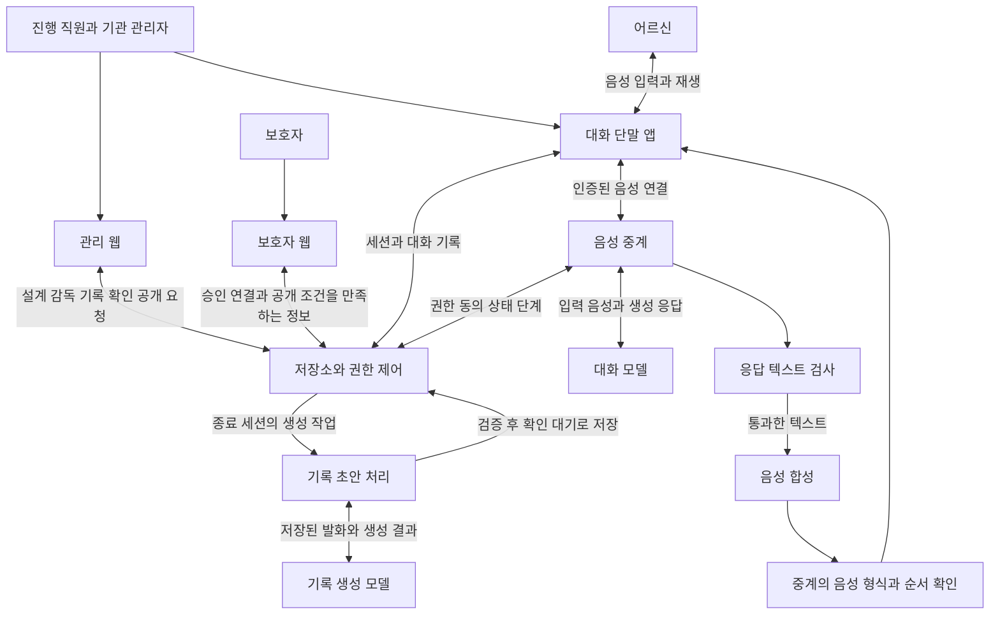
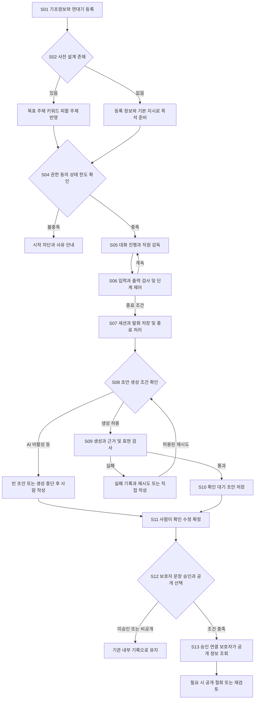
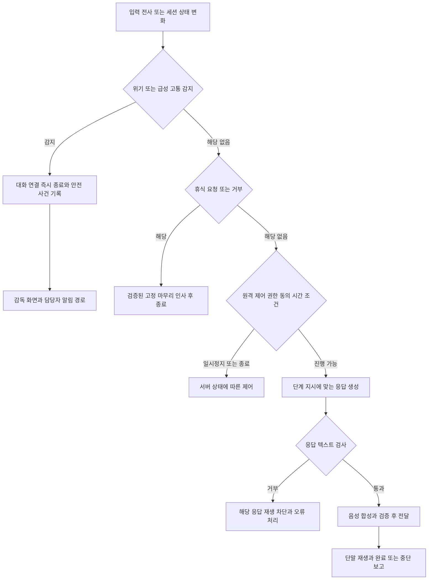
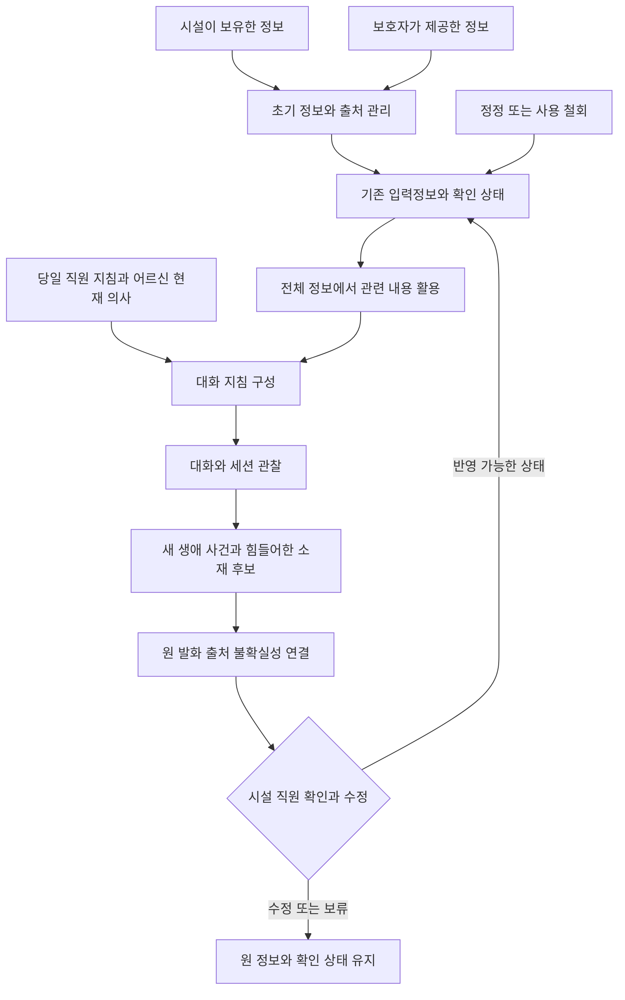

# 회상 대화와 활동 기록 관리 시스템 특허 1차 검토자료

작성일: 2026-11-19  
문서 상태: v0.4 내부 근거용 초안, 개인화 기본안 확정 반영  
출원 단계: 출원 전 최초 검토, 기존 명세서 초안 없음  
전달 목표: 2026-11-20경, 지정 양식·분량 없음  
작성 기준: 저장소 `26175e4`의 문서 및 관련 코드  
수신 대상: 특허 검토 담당 변리사  
작성 주체·출원인·발명자: 확인 예정〔Q13〕

이 자료는 작성 근거와 확인 질문을 포함한 내부 초안입니다. 외부 전달에는 질문 번호와 저장소 경로를 제거한 [전달용 본문](2026-11-19-attorney-review.md)과 [PDF](../../output/pdf/회상대화_활동기록관리_특허1차검토본_20261119.pdf)를 사용합니다.

개인별 회상 정보를 이용한 대화 진행에서 활동 기록 초안 작성, 사람의 확인, 보호자 대상 선택 공개까지의 처리 흐름을 설명합니다. 각 구성의 결합 관계와 구체화가 필요한 부분을 검토받기 위한 자료입니다. 청구범위와 특허 등록 가능성을 확정하는 문서는 아닙니다.

현재 구현을 기반으로 미래 구상까지 폭넓게 검토하되, 구현된 구성·기존에 정한 개발 방향·검토를 위한 제안·회의의 아이디어를 구분합니다. 핵심 목적과 보호받고 싶은 구성의 우선순위는 아직 정하지 않았습니다. 요양원 현장 시험 내용과 결과는 이 자료에 포함하지 않습니다. 화면 첨부 여부와 방식은 보류하며, 본문과 흐름도 작성은 진행합니다.

`확인 예정〔Q번호〕`는 작성자가 사실이나 세부 방식을 확인해야 하는 부분입니다. 번호별 질문과 근거 자료는 [내부 준비 목록](2026-11-19-preparation-notes.md)에 있습니다. 답변을 반영해 외부 전달본을 확정합니다.

## 1 발명의 개요

### 1.1 발명의 가칭

**회상 대화 기반 활동 기록 생성 및 검토와 공유를 제어하는 시스템 및 방법**

가칭은 구성 설명을 위한 것입니다. 아직 출원하지 않았으며 기존 명세서 초안도 없습니다. 회의에서 전달된 제목과 최종 선호 명칭은 확인 예정입니다〔Q19〕.

### 1.2 적용 환경

요양원 또는 주간보호기관에서 직원이 어르신의 회상 대화를 준비·감독하고, 대화 결과를 프로그램 일지 초안과 보호자용 소식으로 정리하는 환경을 대상으로 합니다. 어르신은 음성 대화용 단말을 사용하며, 직원과 기관 관리자는 관리 웹을, 보호자는 별도의 보호자 웹을 이용합니다.

현재 제품의 적용 범위는 비의료적 인지활동과 기록 업무입니다. 인지기능의 개선·악화 판정, 질환 진단, 치료 효과 입증은 현재 구현 설명에 포함하지 않습니다. 사용자 결정에 따라 의료진·병원 피드백은 이번 검토 범위에서 제외합니다〔Q05〕.

### 1.3 해결하려는 문제

대화의 준비·진행, 활동 내용의 정리, 일지 확인, 보호자 안내가 이어지는 과정에서 같은 정보를 다시 옮겨 적거나 서로 다른 결과물을 확인해야 하는 작업이 발생할 수 있습니다. 생성형 AI로 문장을 작성하더라도 원래 대화와 맞는지, 누가 확인했는지, 보호자에게 공개해도 되는지를 별도로 통제할 필요가 있습니다.

본 시스템은 대화 세션과 기록을 연결하고, 생성 결과의 근거와 금지 표현을 검사하며, 사람의 확정과 보호자 공개를 구분해 처리합니다. 목적 후보는 직원의 기록 부담 감소, 기록의 근거 확인, 안전한 대화 운영, 보호자와의 선택적 정보 공유, 확인된 개인 정보의 다음 대화 반영입니다. 단일 핵심 목적은 미정이며 각 처리의 결합을 비교해 검토받고자 합니다〔Q04〕. 비교 대상 업무의 구체적인 단계·소요시간은 별도 확인 사항입니다〔Q08〕. 기존 제품 전체에 동일한 문제가 있거나 본 구성이 없다는 선행기술 조사 결과를 주장하는 것은 아닙니다.

### 1.4 전체 처리의 요지

직원이 등록한 어르신 정보·연대기와 세션 지침을 이용해 대화를 준비합니다. 서버가 권한·동의·세션 상태를 확인하고 대화 단계와 음성 출력을 제어합니다. 대화 종료 후 저장된 발화로부터 기록 초안을 생성하고 검증합니다. 권한 있는 사람이 내용을 확인·수정·확정한 뒤 보호자용 문장을 별도로 승인하고 공개 항목을 선택합니다. 보호자는 승인된 연결과 공개 조건을 만족하는 정보만 조회합니다.

## 2 참여자와 시스템 구성

| 구성 | 역할과 주요 입출력 |
|---|---|
| 어르신 | 음성 대화에 참여하고 질문에 응답하거나 휴식·거부 의사를 표현합니다. 개인 계정으로 로그인하는 대신 직원이 시작한 세션의 표시 모드를 사용합니다. |
| 진행 직원 | 어르신 정보·연대기·세션 지침을 입력하고 단말에서 세션을 시작합니다. 감독 및 기록 확인에 참여합니다. 사용자 역할과 구현 기능에 따른 구성 설명입니다. |
| 기관 관리자·권한 있는 직원 | 기관 설정과 역할·위임을 관리하며, 부여받은 권한에 따라 일지 확정·보호자 연결 승인·공개 철회를 수행합니다. |
| 보호자 | 연결 승인을 받은 어르신의 공개된 소식을 조회합니다. 현재 코드에는 담당 직원과의 양방향 메시지 경로도 있습니다. |
| 대화 단말 | 마이크 입력, 전사·응답 표시, 검증된 음성 재생, 직원 모드와 어르신 표시 모드 전환을 수행합니다. 현재 형태는 모바일·태블릿 앱입니다. |
| 관리·보호자 웹 | 직원의 설계·감독·일지·공개 관리 화면과 보호자용 조회 화면을 제공합니다. 웹 자체에서 어르신 음성 대화를 진행하지 않습니다. |
| 음성 중계 | 세션 권한과 상태를 확인하고 외부 대화 모델에 연결합니다. 입력 안전 판정, 출력 텍스트 검사, 음성 합성·전달, 턴 식별과 재생 영수증을 관리합니다. |
| 기록 처리 서버 | 종료 세션의 초안 생성 작업을 처리하고, 생성 검증·필드 매핑·저장을 수행합니다. 서비스 계정으로 공식 기록을 확정하지 못하도록 제한합니다. |
| 저장소·권한 제어 | 기관·역할·동의·연결·공개 상태에 따라 기록 접근과 상태 전이를 통제합니다. 세션, 발화, 일지, 공개 정보 및 개입·안전 관련 기록을 구분합니다. |
| 외부 AI | 대화 및 기록 초안의 문장 생성과 음성 합성에 사용합니다. 현재 공급자·모델은 실시예의 선택 사항으로 설명하며, 모델 상표 자체를 차별점으로 제시하지 않습니다. |

### 도면 1 시스템 구성

대화 모델의 원본 음성이 단말로 직접 전달되는 경로는 두지 않습니다. 단말에 전달하는 음성은 출력 검사에 통과한 텍스트를 별도로 합성한 결과입니다. 도면은 논리 구성으로, 실제 서비스가 반드시 각각 별도 장비에 설치된다는 의미는 아닙니다.

## 3 처리 데이터와 연결 관계

| 데이터 | 내용과 연결 기준 | 주요 제한 |
|---|---|---|
| 어르신 정보·연대기 | 기본정보와 등록된 삶의 사건·회상 소재를 어르신 식별자에 연결 | 미래 구상의 초기 출처는 시설 보유 정보와 보호자 제공 정보〔Q07〕. 신규 정보는 시설 직원 확인 후 반영하며 충돌 시 원 정보와 확인 대상을 보존 |
| 세션 설계 | 목표, 이야기 지침, 키워드, 피할 주제, 목표 시간 | 설계가 없는 즉석 시작도 구분. 즉석 시작을 별도 추천 알고리즘의 구현으로 단정하지 않음 |
| 세션 | 기관·어르신·실제 진행자·설계자·시간·상태·단계·프롬프트 버전 | 설계자와 실제 시작자를 구분. 단계·실행 한도는 서버가 관리 |
| 발화 기록 | 세션에 연결된 발화자·문장과 전사 출처·수정 정보 | 자동 전사는 음성과 정확히 일치한다고 보증하지 않음 |
| 생성 중 근거 객체 | 생성 주장에 연결된 발화 ID와 인용 | 해당 어르신 발화에 인용 문자열이 존재하는지 검사. 의미적 정확성 전체를 보증하지 않음 |
| 프로그램 일지 | 세션에서 이어받은 항목과 생성 필드·사람 입력, 생성 및 확정 상태 | 현재 일지 필드에 근거 객체 전체가 보존되거나 문장 옆에 표시된다고 설명하지 않음 |
| 보호자용 문장·공개 정보 | 보호자 문장 승인자·시각과 공개 대상·공개 및 철회 상태 | 내부 일지 전체와 구분. 보호자 자유 문장은 생성 주장과 동일한 인용 객체를 갖지 않음 |
| 안전·개입 기록 | 세션의 위험 감지·발췌·담당자 확인 및 감독 개입 | 알림 확인은 위험 해결의 증명이 아님. 기기 잠금화면 푸시에는 민감한 발화·이름을 싣지 않음 |
| 재생 영수증·관찰 | 생성·전달과 구분되는 단말의 완료 또는 중단 보고 | 프로토콜 처리와 장기 DB 보존의 구현 범위를 구분. 영속 저장은 확인이 필요한 계약을 포함함 |

## 4 전체 업무 흐름

### 도면 2 대화에서 기록과 공개까지

### 단계별 입력과 결과

| 단계 | 처리 주체와 입력 | 처리 및 결과 |
|---|---|---|
| S01 | 직원이 어르신 기본정보와 연대기를 입력 | 대상 어르신에 연결해 보관합니다. 자동으로 모델을 재학습하는 단계는 아닙니다. |
| S02~S03 | 직원의 사전 설계 또는 즉석 시작 요청 | 기본정보·등록 연대기와 선택적 세션 지침을 구성합니다. 향후 전체 기존 정보와 직원이 확인한 새 정보를 관리하며 관련 내용을 찾아 다음 대화에 반영합니다〔Q06·Q21~Q23〕. |
| S04 | 인증된 직원과 대상 세션 | 기관·역할·동의·세션 상태와 한도를 확인합니다. 계획된 세션을 채택할 때 실제 진행자 지정과 시작 처리를 서버에서 수행합니다. |
| S05 | 어르신 음성과 구성한 대화 지침 | 단말과 중계를 통해 대화합니다. 직원은 관리 웹에서 세션 상태를 보고 원격 제어를 요청할 수 있습니다. |
| S06 | 입력 전사·생성 응답·서버 상태 | 입력 위험을 검사하고 출력 문장을 검열합니다. 서버의 도입·회상·마무리 단계에 맞춰 진행하며 통과한 응답만 합성·전달합니다. |
| S07 | 종료 조건과 저장된 대화 | 세션과 발화의 연결을 유지하고 종료 상태로 전환합니다. 폴백 저장은 발화 등 기록을 쓴 뒤 종료 처리하도록 순서를 둡니다. 모든 장애에서 무손실을 보장한다는 의미는 아닙니다. |
| S08 | 종료 세션의 생성 작업 | 어르신 발화 유무, 입력 범위, 처리 동의와 기관 AI 초안 설정 등을 확인합니다. 외부 생성 직전과 결과 저장 시점에도 허용 조건을 검사합니다. |
| S09 | 발화 목록과 생성 결과 | 구조와 근거 인용·금지 표현을 검사한 뒤 일지 필드로 매핑합니다. 처리 단계에 따라 작업 실패 또는 특정 필드 비움으로 이어집니다. |
| S10 | 검증 결과와 세션 메타데이터 | 초안을 확인 대기로 저장합니다. 생성 워커가 사람 대신 확정하지 못하도록 서버에서 제한합니다. |
| S11 | 권한 있는 사람의 확인·수정·확정 요청 | 진행자 등 필수 조건과 확정 권한을 검사하고 확정자·시각을 기록합니다. 확정 후 수정에는 사유와 이력 처리 경로가 있습니다. |
| S12 | 보호자용 문장과 공개 선택 | 확정, 보호자 문장 승인, 공개 요청의 권한을 검사합니다. 생성됐다는 이유만으로 보호자에게 자동 전달하지 않습니다. |
| S13~S14 | 보호자의 승인된 연결과 활성 공개 항목 | 허용된 정보만 조회합니다. 철회 후 서버의 접근을 제한합니다. 이미 본 정보나 외부에 저장한 사본의 회수까지 의미하지는 않습니다. |

## 5 대화 중 제어와 예외 처리

### 도면 3 대화 중 판단 경로

입력 위험 검사는 외부 대화 모델에서 전사가 돌아온 뒤 수행되는 경로입니다. 외부로 음성을 보내기 전에 모든 위험을 판정한다는 구조로 설명하지 않습니다.

| 상황 | 현재 구성의 처리 | 설명할 때의 한계 |
|---|---|---|
| 위기·급성 고통 | 연결을 즉시 종료하고 안전 사건 및 알림 경로로 연결 | 모든 위험의 탐지·실제 대응 성공을 보증하지 않음 |
| 휴식 요청·거부 | 별도의 고정 마무리 인사를 검사·합성해 재생한 뒤 종료 | 위기 경로를 단순 일시정지로 낮추지 않음 |
| 직원의 원격 제어 | 서버가 요청과 상태를 관리하고 중계·앱이 반영 | 화면 버튼만 숨기는 접근 제어로 설명하지 않음 |
| 재생 중 어르신 발화 | 에코 제거 입력 경로와 중단 영수증을 사용해 기존 재생을 중단하고 입력 처리 | 완료와 중단을 구분. 기기·환경별 음성 품질 검증은 별도 |
| 지연된 전사·이전 턴 완료 | 턴 식별과 상태에 따라 채택·보류·폐기하며 다음 입력과 혼동을 방지 | 코드에서 정한 범위의 비동기 제어이며 일반적인 무오류 보장이 아님 |
| 권한·동의 상실 | 서버 검사 결과에 따라 연결·처리·결과 저장을 제한 | 검사 간격이나 이미 수행된 처리를 소급 취소하는 범위는 별도 검토 |
| 초안 생성 실패 | 실패 상태·오류 안내와 허용된 재시도 또는 사람 작성 | HTTP 접수 응답은 생성 성공 판정이 아님 |

현재 파일럿 설정은 세션당 최대 10분, 진행 직원 1명당 동시 최대 4대, 어르신 1명당 실행 중 세션 1개입니다. 이 수치는 현재 실시예의 운영 제약으로 기재하며 발명의 필수 수치인지 여부는 변리사 검토를 요청합니다.

## 6 기록 생성과 사람 확인의 결합

### 6.1 세션 종료와 생성 작업의 연결

세션 종료를 계기로 서버가 일지 생성 작업을 등록하고 워커가 처리합니다. 사용자가 정상 흐름에서 별도의 ‘초안 생성’ 버튼을 눌러야 하는 구조가 아닙니다. 생성 작업은 종료 세션의 식별자로 발화를 읽으며, 입력이 충분하지 않거나 허용 조건이 충족되지 않으면 결과를 지어내 확정하지 않습니다.

### 6.2 생성 주장과 발화 근거 검사

요약·주제·진행 내용 등의 생성 주장에는 문장과 함께 어르신 발화 ID 및 짧은 원문 인용을 요구합니다. 서버는 식별자가 가리키는 어르신 발화에 해당 인용이 존재하는지 검사합니다. 근거 없는 인용이나 지원하지 않는 결론을 포함한 출력은 정상 결과로 취급하지 않습니다.

이 검사는 인용 문자열의 존재와 출력 계약을 확인하는 처리입니다. 인용이 존재하더라도 생성 문장의 주체·행동 관계가 잘못 묶일 수 있으므로 문장 전체의 사실 정확성을 보증하지 않습니다. 또한 현재 프로그램 일지는 검사된 생성 문장을 필드 문자열로 매핑하며, 모든 근거 객체를 일지에 영속 보존하거나 문장 옆에서 보여 주는 기능은 구현 완료로 제시하지 않습니다.

보호자용 자유 문장은 별도 필드이며 길이·진단 표현 등의 검사를 받습니다. 위의 주장 객체와 동일한 발화별 인용 검사를 받는다고 확대 설명하지 않습니다.

### 6.3 자동으로 채우는 영역과 사람의 영역

현재 생성 필드에는 진행 내용·참여자 반응·의견수렴·보호자용 문장이 있습니다. 근거가 없는 의견수렴은 비워 둘 수 있습니다. 종합평가와 다음 계획은 현재 매핑에서 비워 두며 사람이 작성합니다. 일자·시간·진행자·유형 등은 세션이나 기관 설정의 데이터를 이용합니다.

프로그램 일지의 사람 진행자와 AI 도구 사용 사실을 별도 항목으로 구분합니다. 자동 작성 결과가 있다는 이유로 사람의 감독·확정이 수행됐다고 간주하지 않습니다.

### 6.4 상태 전이와 공개 조건

| 상태 또는 작업 | 수행 주체 | 서버의 주요 검사 |
|---|---|---|
| 생성 중 → 확인 대기 | 기록 생성 워커 | 작업 자격, 동의·기관 설정, 결과 저장 조건 |
| 확인 대기 → 확정 | 인증된 권한자 | 확정 권한, 사람 계정, 진행자와 필수 내용 등 |
| 보호자 문장 승인 | 인증된 사람 | 승인 주체와 대상, 승인 상태 |
| 보호자 공개 | 공개 요청자 | 일지 확정, 문장 승인, 작업 권한과 공개 대상 |
| 보호자 조회 | 승인 연결 보호자 | 대상 어르신의 연결 승인, 유효한 공개, 데이터 접근 범위 |
| 공개 철회·관련 내용 변경 | 권한자 또는 정해진 서버 처리 | 위임 권한, 승인 무효화·공개 철회 조건 |

확정·승인·공개는 서로 다른 조건입니다. 정확한 공개 및 철회 권한의 위임 범위는 각 서버 계약을 따르며 일반화하지 않습니다.

## 7 보관과 접근 제어

기록은 기관·어르신·세션의 식별자를 기준으로 연결합니다. 같은 기관 돌봄팀의 접근, 기관 관리 권한, 보호자 연결과 공개 범위를 구분하며 저장소에서 접근 조건을 집행합니다. 담당 배정은 일반적인 기관 내부 열람의 유일한 조건이 아니며 알림 대상이나 담당 필터 등에 사용합니다.

외부 AI 키는 서버에서 관리합니다. 단말은 인증된 중계 경로를 이용하며 세션 권한과 동의 검사를 거칩니다. 생성 중 동의가 철회되는 경우 외부 전송 직전 및 저장 직전의 검사로 처리 조건을 재확인합니다.

DB·중계의 국내 운영 위치와 외부 AI 처리 위치는 구분해야 합니다. 현재 자료만으로 모든 데이터 처리가 국내에서만 이루어진다고 설명하지 않습니다. 기록 종류별 최종 보존기간은 법무·운영 결정이 남아 있어 본 자료에서 확정하지 않습니다.

## 8 기술적 차이와 효과를 검토할 후보

다음은 선행기술과 대비해 검토받고자 하는 결합 구성입니다. 각각의 신규성·진보성이 확인됐다는 의미는 아닙니다.

| 후보 | 처리의 결합 관계 | 검토할 효과와 확인 방법 |
|---|---|---|
| A 대화와 확인 가능한 기록 초안의 연결 | 개인별 정보·세션 지침 → 제어된 대화 → 세션 발화 → 근거 검사 → 일지 필드 매핑 | 재입력 부담과 근거 확인 작업의 변화. 수작업 작성 및 수정 시간을 비교 |
| B 생성과 공식화 및 외부 공개의 분리 | 워커의 확인 대기 저장 → 사람 확정 → 보호자 문장 승인 → 선택 공개 → 연결 조건에 따른 조회 | 미확정·미승인 결과의 외부 노출 차단. 서버 직접 요청을 포함한 접근·상태 전이 시험 |
| C 출력 검증과 음성 전달의 연결 | 전체 응답 텍스트 검사 → 별도 음성 합성 → 형식·순서 확인 → 단말 전달 | 검사되지 않은 생성 응답이 재생되는 경로의 제한. 차단 사례와 취소·오류 경로 시험 |
| D 생성 전달 재생 및 다음 입력의 분리 | 턴 식별 → 검증 후 음성 스트리밍 → 완료·중단 보고 → 다음 입력 채택 순서 제어 | 끼어들기 시 이전 출력과 다음 입력의 혼동 제한. 지연·중단·늦은 이벤트 조합 시험 |
| E 위험 감지와 감독 및 기록의 연결 | 입력 전사 판정 → 즉시 종료 → 사건·발췌 보관 → 감독 화면과 알림 | 위험 신호 발견 후 직원 확인을 지원. 미탐·오탐과 알림 도달·대응 시간을 각각 측정 |
| F 개인별 정보 갱신과 다음 대화의 연결〔향후〕 | 시설·보호자 초기 정보 + 대화에서 새로 알게 된 생애 사건·힘들어한 소재 → 시설 직원 확인·수정 → 관련 정보를 찾아 다음 대화에 반영 | 전체 기존 정보를 보관하고 관련 정보를 활용. 충돌 시 원 정보를 보존하고 직원 확인 대상으로 표시 |
| G 비동기 감정 검사와 직원 개입의 연결〔향후〕 | 음성 품질 확인 → 음성 특징·감정 후보 추정 → 전사 의미·본인 의사와 구분 → 일시정지·직원 확인 → 조치 기록 | 음성 재생 지연과 직원 개입 판단을 구분하는 설계. 기존 명확한 위험 즉시 종료를 유지 |
| H 관찰과 판단을 분리한 기간별 자료 생성〔제안〕 | 출처가 다른 관찰·모델 추정·직원 의견을 구분 → 비교 가능한 기간 자료 선택 → 검토용 변화 자료 구성 → 승인 후 수신자별 제공 | 진단이나 개선 판정으로 합치지 않고 사람이 판단할 근거를 구성. 전달 대상·구체 지표는 미정 |

출원에서 중심으로 삼을 목적과 위 후보의 우선순위는 현재 미정입니다〔Q04〕. 위 표의 순서는 권리화 우선순위가 아닙니다. 기능의 개수보다 각 요소가 서로 필요한 이유와 데이터·상태의 연결 관계를 중심으로 검토를 요청합니다.

## 9 구현 형태와 검증 범위

현재 제품은 음성 대화 앱과 기관·보호자 관리 웹, 서버 중계 및 기록 생성 워커로 구현돼 있습니다. 이 장은 저장소 문서와 코드로 확인한 구성의 범위를 설명합니다. 요양원 현장 시험·참여자·사용 후기·성과는 제시하지 않습니다. 구현·자동 회귀 검증을 정량적인 업무 개선 효과로 해석하지 않습니다.

| 항목 | 확인된 자료 | 현재 설명 가능한 범위 |
|---|---|---|
| 개인 정보·연대기·선택적 설계 반영 | 프롬프트 구성 및 파일럿 계획 | 등록 정보로 대화를 준비하는 구성. 자체 모델의 실시간 재학습으로 설명하지 않음 |
| 출력 검사 후 음성 합성 | 중계 구현 및 안전 정책 | 검사 경유 구성. 모든 유해 표현을 검출한다는 주장 제외 |
| 음성 스트리밍·끼어들기 | 중계·단말 코드와 구현 계획 | 턴·청크·영수증·중단 처리의 구현. 모든 기기의 음성 품질과 전체 지연 목표 달성을 뜻하지 않음 |
| 일지 생성·확정 | 생성 워커·일지 매핑·서버 상태 전이 계약 | 초안 생성과 사람 확정의 분리. 현장 성공률이나 오류 감소율을 제시하지 않음 |
| 일지 내용 검증 | 생성 검증·필드 매핑 코드 | 인용 존재·구조·표현 검사 범위. 의미 정확성 전체를 보증하지 않음 |
| 보호자 공개와 접근 제한 | 파일럿 계획·권한 회귀 자료 | 코드·회귀의 검증 범위. 실제 보호자 사용·반응을 성과로 제시하지 않음 |
| 재생 관찰 영속 저장 | 저장 계약 문서·어댑터·관련 계획 | 중계 영수증 구현과 달리 저장 RPC는 문서상 미구현이며 저장소 마이그레이션 정의가 확인되지 않음. 운영 보존 완료로 기재하지 않음 |

현재 문서의 자동 테스트 수를 현장 사용 인원이나 업무 효과로 환산하지 않습니다. 개발 단계의 기술 검증 자료를 추가할 경우 확인한 구성·시험 조건·범위를 명시하고 현장 시험과 구분합니다.

### 화면 첨부 후보 보류

| 그림 | 보여 줄 화면과 설명 | 준비 상태 |
|---|---|---|
| 화면 A | 어르신 정보·연대기와 등록 주체 | 방식 결정 전 보류〔Q11〕 |
| 화면 B | 세션 목표·소재·피할 주제·시간 설정 | 방식 결정 전 보류〔Q11〕 |
| 화면 C | 대화 단말의 어르신 표시 모드 | 방식 결정 전 보류〔Q11〕 |
| 화면 D | 기관 감독 화면의 단계·상태·원격 제어 | 방식 결정 전 보류〔Q11〕 |
| 화면 E | 생성 후 확인 대기 일지와 사람 확정 | 방식 결정 전 보류〔Q11〕 |
| 화면 F | 보호자 문장 승인·선택 공개 및 보호자 조회 | 방식 결정 전 보류〔Q11〕 |

사용자는 화면 첨부 방식을 추후 결정하기로 했습니다. 위 표는 설명에 사용할 수 있는 후보이며 촬영·첨부를 승인하거나 필수로 확정한 목록이 아닙니다. 첨부 시에는 개인정보 제거와 화면 출처 표시 방법을 정하고, 설명용 재현 화면과 실제 기록 화면을 구분합니다. 화면 결정은 본문·흐름도 작성의 선행 조건으로 두지 않습니다.

## 10 효과 측정 계획

현재 업무시간 절감률, 기록 오류 감소율, 임상적 개선 수치는 확정하지 않습니다. 다음은 향후 측정안이며 수행 결과가 아닙니다.

| 지표 | 측정 내용 | 비교 시 유의점 |
|---|---|---|
| 일지 1건당 사람 작업시간 | 읽기·확인·입력·수정·확정에 실제 사용한 시간 | 같은 활동 자료와 기록 완성 기준을 사용. 자동 생성 대기시간과 구분 |
| 최종 확정까지의 경과시간 | 종료 또는 작성 시작부터 확정까지 | 업무 중 다른 일로 인한 대기를 분리해 해석 |
| 사실 오류와 수정 부담 | 잘못된 주체·행동·날짜·누락 및 수정 항목·시간 | 원 발화·현장 기록을 기준으로 검토. 오탈자와 사실 오류를 구분 |
| 생성 실패와 복구 부담 | 생성 시도·실패·재시도·수동 전환 | 성공 건만 선정하지 않고 대상 전체의 분모 기록 |
| 보호자 안내 작성 부담 | 문장 확인·수정·승인·공개에 든 시간 | 원문 전체를 제공하는 방식과 같은 작업이라고 간주하지 않음 |
| 안전·음성 기술 지표 | 정의된 사례의 판정·알림 도달과 발화 종료부터 실제 첫 재생까지의 시간 | 서버 전송 시각·합성 첫 청크 시각·단말 실제 재생 시각을 구분 |

현재 제품 이벤트에는 일부 초안 수정 필드 기록이 있으나 총 업무시간·열람시간 전체가 계측됐다는 근거는 없습니다. 이 표는 향후 별도 효과 검증을 위한 제안이며 이번 검토본 전달 전에 현장 시험을 다시 수행해야 한다는 조건이 아닙니다. 실제 측정을 추진하는 시점에 비교 기준·반복 수·실행 책임자 등을 정합니다〔Q08·Q18〕.

## 11 향후 설계와 별도 검토 범위

사용자 요청에 따라 미래 구상까지 폭넓게 포함합니다. 이 장의 흐름은 현재 구현과 구분하며, 구현 완료나 모든 세부 방식에 대한 사용자 확정을 뜻하지 않습니다. 이미 정한 개발 방향은 기존 기획을 따르고, 아직 없는 구체적 연결은 검토용 제안으로 표시합니다.

### 11.1 미래 구성의 출처와 확정 수준

| 확장 항목 | 기존 기획의 방향 | 구체화 또는 판단이 필요한 사항 |
|---|---|---|
| 전사 의미와 음성 특징을 이용한 위험·감정 검사 | 파일럿 이후 기획. 기존 명확한 위험 즉시 종료는 유지. 감정 추정은 비동기 검사와 직원 확인 경로로 설계 | 모델·판정 조건·미응답 대응 등 미정. 감정을 실제 내면 상태의 확정으로 표현하지 않음 |
| 기존 정보와 신규 생애 사건·힘들어한 소재의 반영 | 초기 출처는 시설 보유 정보+보호자 제공 정보. 전체 정보를 보관하고 관련 내용을 활용하며 신규 후보는 시설 직원 확인·수정 후 반영 | 사용자 기본안 확정〔Q21~Q23〕. 충돌은 원 정보 보존과 직원 확인 표시. 검색 기법·화면 등은 후속 구체화 |
| 로봇·인형 등 단말 | 회의에서 논의한 다른 출력·입력 단말 형태 | 실제 추진 여부와 기존 단말 대비 동작 차이를 확인〔Q15〕 |
| 연대기 동화책 | 회상 데이터의 별도 가공·편집·출판 방향 | 이번 검토와의 관계 및 별도 검토 착수 여부 확인〔Q16〕 |
| ERP·공단 시스템 연결 | 현재 파일럿 범위 밖 | 공단 형식의 일지와 시스템 직접 연동을 구분. 현재 연동 완료로 기재하지 않음 |

### 11.2 개인별 정보 갱신과 대화 준비의 순환 구조

사용자는 미래 구상의 초기 정보를 시설이 보유한 정보와 보호자가 제공하는 정보로 정했습니다. 다음 대화에는 기존에 입력한 정보와 대화에서 새로 알게 된 생애 사건, 힘들어한 소재까지 반영하는 방향입니다〔Q06·Q07〕. 기본안으로 전체 기존 정보 보관과 관련 내용 활용, 신규 정보의 시설 직원 확인·수정 후 반영, 상충 시 원 정보 보존과 직원 확인 대상 표시를 확정했습니다〔Q21~Q23〕.

현재 프롬프트 구성은 등록된 프로필과 연대기 중 상위 10개 항목을 이용합니다. 따라서 미래의 전체 입력정보 활용과 현재 구현을 같다고 설명하지 않습니다. 향후에는 전체 정보를 관리하면서 해당 주제·발화에 관련된 내용을 찾아 활용합니다. 아래는 확정된 기본안을 반영한 처리 순서이며 검색 기법·확인 화면·세부 데이터 계약은 후속으로 구체화합니다.

1. 시설 보유 정보와 보호자 제공 정보에 출처를 연결해 어르신별 초기 정보로 관리합니다. 초기 입력을 수동으로 할지, 파일·시스템에서 가져올지는 미정입니다.
2. 대화에서 새로 알게 된 생애 사건과 힘들어한 소재를 후보로 구분합니다. 힘들어한 소재에 관한 발화·반응 관찰과 모델의 해석을 분리합니다.
3. 각 후보에 원 세션·발화·출처·생성 시점과 아직 확인되지 않았다는 상태를 연결합니다.
4. 시설 직원이 후보를 확인·수정한 뒤 반영합니다. 상충 정보는 원래 정보를 보존하고 직원 확인 대상으로 표시하며, 확인되지 않은 새 정보로 기존 사실을 자동 덮어쓰지 않습니다〔Q21·Q23〕.
5. 전체 기존 정보와 확인된 새 정보 중 관련 내용을 찾아 당일 직원 지침·어르신 현재 의사와 함께 다음 세션에 반영합니다〔Q22〕.
6. 이번 반영 정보와 이후 반응을 연결해 다시 검토할 수 있게 하는 방식을 검토합니다. 부정적 반응을 임상 상태 악화나 영구적인 회피 선호로 즉시 확정하지 않습니다.

### 도면 4 향후 개인화와 사람 확인의 순환 제안

이 순환은 개인별 저장 정보의 갱신·조회입니다. 공용 모델의 가중치를 매 대화마다 수정하는 학습과 구분합니다. 현재 일지의 종합평가·다음 계획을 AI가 자동 작성하는 구현으로 읽지 않습니다.

### 11.3 전사 의미와 음성 특징을 이용한 직원 확인

기존 위험·감정 후속 기획은 전사의 주체·시점·부정·인용 맥락, 음성의 속도·음량·침묵 등 관찰, 모델의 감정 후보, 본인의 계속·휴식 의사, 직원의 관찰을 구분하는 방향입니다. 음질·화자·에코 등의 품질이 불충분하면 감정 해석을 보류하고, 개인 기준선이 없을 때는 자료 부족으로 표시하도록 제안돼 있습니다.

재생을 허용하는 검사는 기존 규칙과 소형 텍스트 분류기 경로로 설계하고, 감정 모델은 재생을 막지 않는 비동기 검사로 분리합니다. 신규 감정 기반 직원 확인 경로에서는 판단 근거를 연결해 대화를 일시정지하고 직원 확인·조치를 기록하는 방향입니다. 이미 정한 명확한 위험·급성 고통의 즉시 종료를 감정 점수로 무효화하지 않습니다.

일시정지 중에는 듣지 않으며, 재개 때 새 연결과 복구 맥락으로 여는 것은 기존에 정한 방향입니다. 직원 미응답 시의 정책, 구체적인 임계값·품질 조건·재개 정책 등은 아직 미정입니다. 이를 제품의 확정 동작으로 채우지 않고 추가 설명 대상으로 남깁니다.

### 11.4 기간별 관찰 자료와 수신자별 제공 제안

회의의 ‘어제와 오늘 비교’는 우선 비교 가능한 관찰 자료를 사람에게 제공하는 구상으로 구체화할 수 있습니다. 검토용 제안은 동일 어르신의 세션·관찰 출처·입력 품질·자료량을 확인하고, 비교 가능한 구간만 선택한 뒤 실제 관찰, 모델 추정, 직원 의견을 구분해 표시하는 방식입니다. 자료가 부족하거나 입력 조건이 다른 경우 해당 한계를 표시합니다.

기관 돌봄팀의 내부 검토 자료와 보호자용 소식은 목적과 공개 범위를 구분합니다. 이 제안의 수신자는 기관 돌봄팀과 공개 조건을 충족하는 보호자 범위이며, 관찰 비교를 인지기능 개선율·질환 악화·치료 효과로 자동 변환하는 방식은 제안하지 않습니다.

### 11.5 서비스 운영과 별개인 장기 모델 학습

기존 계획은 적법하게 확보하고 검수한 자료로 음성 인식과 대화 모델을 각각 특화하고 평가한 후, 승인된 구성요소부터 교체하는 방향입니다. 개인 정보 조회, 현재 세션의 맥락 반영, 장기 모델 학습을 서로 다른 처리로 설명합니다.

검토할 데이터 흐름은 사용 목적·허용 범위·철회 상태를 확인한 자료의 선별, 사람 전사·대응 검수, 데이터셋과 모델 버전의 연결, 분리된 평가, 운영 책임자의 전환 판단입니다. 외부 모델의 참여 세션이나 출력·파생 자료를 자동으로 학습에 사용하는 것으로 기재하지 않습니다. 해당 자료의 사용 가능 범위는 별도 확인이 필요한 기존 기획 조건입니다.

### 11.6 다른 단말과 데이터 활용 방향

로봇·인형·전용 단말은 회의의 아이디어로 포함하되, 구체적인 마이크·스피커·표시부·제어부와 기존 앱 대비 동작 차이는 확인 후 작성합니다〔Q15〕. 단말 형태가 달라져도 서버의 세션·권한·검증·기록 연결을 이용할 수 있는지 검토하는 수준입니다.

연대기 동화책은 대화 데이터의 가공·편집·삽화·검수·출판이 추가되는 별도 검토 방향으로 기록합니다. 이번 자동화 흐름에 어떤 연결 설명을 둘지와 별도 자료 작성 여부는 확인 예정입니다〔Q16〕. 미래 구상을 폭넓게 담는다는 지시만으로 출판 시스템의 세부 구성이 합의됐다고 간주하지 않습니다.

## 12 변리사 검토 요청 사항

1. 대화 준비·진행·기록 생성·확정·공개의 전체 결합 중 어떤 처리 관계를 중심으로 구체화하는 것이 적절한지 검토를 요청합니다.
2. 근거 인용 검사, 사람 확정과 공개 승인 분리, 검증 후 음성 합성, 턴·재생 상태 제어의 결합을 선행기술과 비교해 주시기 바랍니다.
3. 현재 구현과 미래 구상을 폭넓게 제시한 자료에서, 우선 구체화할 알고리즘·데이터 구조·분기 조건을 알려주시기 바랍니다.
4. 화면 첨부 방식은 보류 중입니다. 본문의 구성·흐름 검토 후 추가로 필요한 화면이나 기술 검증 자료를 알려주시기 바랍니다.
5. 로봇 단말·연대기 출판의 검토 관계는 현재 구성과 각각의 구체화 수준을 바탕으로 논의하고자 합니다.

현재 출원 전 최초 검토 단계입니다. 공개 이력, 기술적 기여와 출원인 관련 사항은 작성자가 확인한 자료로 별도 전달합니다. 변리사 검토 전까지 확인되지 않은 등록 가능성·권리 범위·효과 수치를 본 자료의 결론으로 제시하지 않습니다.

## 부록 주요 작성 근거

| 근거 | 사용 범위 |
|---|---|
| [프로젝트 규칙](../../AGENTS.md) | 제품 목적·역할·안전·확정·공개 원칙 |
| [파일럿 개발 계획](../plans/pilot-development-plan.md) | 현재 범위·일지·감독·동의·제어·자동 생성 |
| [구조와 기술 기준](../structure.md) | 참여자와 논리적 시스템 구성. 오래된 부분은 현행 규칙·구현으로 보완 |
| [DB 계약](../database.md) | 접근 모델·전사 출처·재생 관찰 저장의 미구현 범위 |
| [AI 안전](../ai-safety.md) | 파일럿 기준의 입력·출력·사람 확인. 구 규칙 기반 대화의 과거 설명은 제외 |
| [동시 입출력 구현](../plans/2026-10-16-duplex-voice-implementation.md) | 끼어들기·중단 영수증과 관측 한계 |
| [검증 후 음성 스트리밍](../plans/2026-10-17-streaming-voice-implementation.md) | 생성·공급자 턴 종료·재생 상태 분리 |
| [음성 개인화 계획](../plans/voice-ai-personalization.md) | 개인 의미·대화 지원 정보와 모델 학습의 구분, 장기 설계 |
| [위험·감정 후속 기획](../plans/2026-11-13-risk-emotion-detection.md) | 현재 미구현인 확장 설계의 경계 |
| [작업 상태](../tasks.md) | 코드·배포·실기기 확인을 구분한 상태 기록 |

코드 대조와 확인이 필요한 문서 간 차이는 [내부 준비 목록](2026-11-19-preparation-notes.md)에 기록했습니다. 본 부록의 상대 경로는 저장소 내부용이며, 외부 전달 시 필요한 도면·화면·설명을 파일 안에 포함해 전달합니다.
