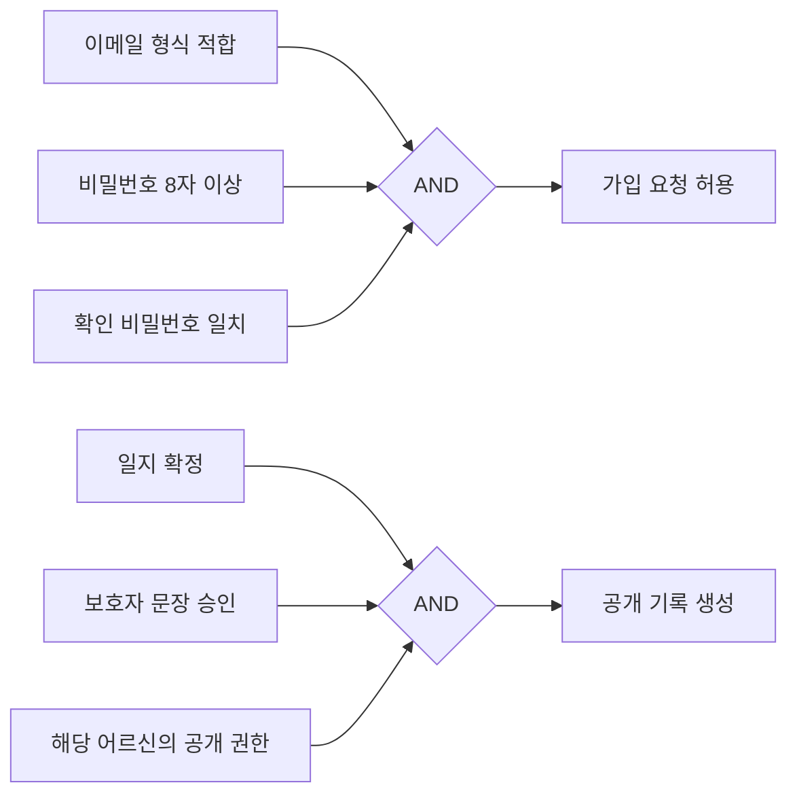

# 블랙박스 테스트 결과 — 2026-10-24

> **수정 전 시험 기록이다.** ✅ 2026-10-24 후속 BB-01 코드 수정·로컬 재실행에서 35/35 통과했다. [수정·재검증](2026-10-24-bb01-fix.md). 아래 원래 실패 판정·증거는 보존한다.

**판정: 로컬에서 실행한 범위는 검증 완료, 제품 전체 합격은 보류.** 재현한 기능 결함 1건(BB-01)이 있고, 실제 앱·OAuth·푸시·Gemini 종단은 남았다. 기능 수정·운영 DB 쓰기·배포·화이트박스 커버리지 측정은 수행하지 않았다.

| 실행 묶음 | 결과 | 증거 |
|---|---|---|
| 새 화면 사례: 여섯 기법 적용 | **35건 중 34 통과 / 1 실패** | [사례별 입력·관찰·실패](evidence/2026-10-24/ui-cases.json), [실행 로그](evidence/2026-10-24/ui-run.log.txt) |
| 새 서버 공개 결정 테이블 | **8조합 모두 통과** | [8행 결과](evidence/2026-10-24/share-decision-table.log.txt) |
| 공개 페이지·미인증 경로·CSP 스모크 | **67/67 통과, 콘솔 오류 0** | [라우트 로그](evidence/2026-10-24/routes.log.txt) |
| 기존 웹 사용자 흐름 | **11개 스위트 모두 통과** | [흐름별 로그](evidence/2026-10-24/web-flows.log.txt) |
| 기존 DB 보조 회귀 | **17개 스위트 모두 통과** | [새 격리 DB 재실행 로그](evidence/2026-10-24/database-runner.log.txt) |

사례 수와 스위트 수는 단위가 다르고 겹치는 시나리오가 있으므로 합산하지 않는다. 실행 환경·기준 커밋은 [summary.json](evidence/2026-10-24/summary.json)에 기록했다.

## 1. 시험 기준과 범위

- 대상: `main`의 `ee1d3de6dfc3c457e71f48b69fc62285f719ced1` 및 이 작업에서 추가한 시험 도구. 실행일은 한국 시각 2026-10-24.
- 판정 기준: [요구사항](../requirements.md)의 PF-01~18, PF-19~24, PF-37~43, PF-47, PN-01·PN-09와 [파일럿 계획](../plans/pilot-development-plan.md), 기존 웹 흐름 계약. 모든 요구사항을 완전히 커버했다는 뜻은 아니다.
- 환경: Windows, Node v24.16.0, pnpm 10.33.0, 설치된 Microsoft Edge의 headless Playwright, 격리된 PostgreSQL 16. 마이그레이션 84개를 새 DB에 순차 적용했다.
- 공개 인증 폼과 로그인 복귀는 실제 제품 빌드·AuthProvider·라우터를 사용하고, HTTP 응답만 합성했다. 가입 유효값은 서버 요청까지 허용되는지 확인했으며 실제 계정 가입·메일 발송 성공을 뜻하지 않는다.
- 로그인 뒤 화면의 다수 사례는 기존 감사 빌드의 합성 인증·캐시 픽스처를 이용했다. 상태를 주입하는 준비 과정은 내부 테스트 통로를 사용하지만, 판정 대상은 화면·버튼·외부 요청·이동 결과다. 이 결과만으로 운영 인증/RLS를 증명하지 않는다.
- 서버 공개 8조합은 합성 HTTP가 아니라 **실제 PG16의 공개 테이블 요청**으로 검사했다. Supabase Auth/Storage/pg_net/cron은 기존 테스트 심을 사용하므로 운영 Supabase 서비스 전체와 동일하지 않다.
- 기존 DB 회귀에는 스키마·권한 구성 보조 단언도 포함된다. 17개 스위트 결과는 보조 자료로 분리하며 블랙박스 사례 수나 문장·분기 커버리지에 포함하지 않는다.
- `.env` 등 민감 파일을 읽지 않았다. 새 Docker DB는 `--network none`으로 생성했고 합성 데이터만 썼다. 시험 뒤 해당 컨테이너를 삭제했다.

## 2. 여섯 기법별 실행 근거

| 기법 | 분할·조건·입력 | 기대 결과 | 실제 결과·사례 |
|---|---|---|---|
| **동등 분할** | 인증 필드 빈값/이메일 형식 오류/7자/8자/비밀번호 불일치·일치 | 부적합 입력 요청 차단, 적합 입력만 서버 요청 | 가입 8조합 및 빈값 5건 통과 (`DT-SIGN-*`, `EP-EMPTY-*`) |
| 동등 분할 | 목표 시간 0/5/10/11/30분 | 메뉴는 5~10분만 제공 | `EP-TIME-*` 5건 통과. 서버 상한은 DB 보조 회귀에서도 확인 |
| 동등 분할 | 문의 제목 101자·본문 5001자 입력 | 각각 100자·5000자로 제한 | `EP-INQUIRY-100/5000` 통과 |
| **원인-결과 그래프** | 이메일·길이·확인 일치 → 요청; 일지 확정·문장 승인·권한 → 공개 | AND 결합의 모든 원인이 참일 때만 허용 | 두 그래프 각각 8조합 통과(아래 §3) |
| **결정 테이블** | 가입 8행·공개 8행·일지 확정 역할 4종 | 허용 조합 일치, 기본 요양보호사 확정 불가 | `DT-SIGN-*`, `DT-SHARE-*`, `DT-FINAL-*` 통과 |
| **상태 전이** | 가입 가능→처리 중→거절→재시도 | 처리 중 중복 차단, 실패 후 다시 사용 가능 | `ST-SIGN-RETRY` 통과 |
| 상태 전이 | 일지 생성 중/확인 대기/확정/실패 화면 | 실패 상태만 다시 생성, 자동 확정·수동 초안 생성 없음 | `ST-JOURNAL-*` 4건 + 기존 일지 흐름 통과. 화면 4건 자체는 상태별 렌더 시험이며 전체 생성 생명주기는 아님 |
| 상태 전이 | 세션 종료→일지 생성, 권한 있는 사람의 확정, 확정 후 사유 수정, 공개 철회 | 자동 처리는 초안까지, 확정·공개 가드 유지 | 실제 DB 보조 회귀 `pilot_access`, `journal_worker`, `share_auto_revoke`, `finalized_journal_integrity` 통과 |
| 상태 전이 | 감독 링크→로그인→원래 화면 | 감독 화면 복귀 | **`ST-LOGIN-RETURN` 실패(BB-01)** |
| **오류 예측** | 버전 충돌·첨부 2개 중 1개 실패·조회 실패·삭제 취소 | 보지 않은 내용 승인 차단, 성공 첨부 보존, 실패 표시, 취소 무동작 | 기존 journal/share/grade/elder-delete/supervision 흐름 통과 |
| 오류 예측 | 비로그인 문의 등록·HTML 이벤트 문자열 | 서버 쓰기 차단, 문자열은 텍스트로 렌더 | `EG-INQUIRY-ANON`, `EG-XSS-JOURNAL` 통과 |
| **비교** | 같은 순간을 서울/UTC/LA 기기에서 표시 | 모두 한국 날짜 2026-10-24 | `CMP-DATE-*` 3건 통과 |
| 비교 | 서울·UTC 연대기 재저장·재열기, 3→6개월 선택, 좁은 PC창·휴대폰 | 날짜 보존, 기간별 데이터 일치, 고정 캔버스/감독 반응형 계약 유지 | chronicle/analysis-period/viewport 흐름 통과 |

## 3. 원인-결과 그래프와 결정 테이블

가입의 E=이메일 형식 적합, L=비밀번호 8자 이상, M=확인 비밀번호 일치다. 결과 R은 **가입 성공이 아니라 서버로 가입 요청을 보낼 수 있음**이다. 서버는 합성 오류를 반환하게 했다.



공개 권한 P=1은 해당 기관 관리자, P=0은 같은 기관이지만 해당 어르신에 배정되지 않은 요양보호사로 시험했다. 모든 역할·배정 조합을 전수 검사했다는 뜻은 아니다. 새 공개 테이블 사례는 매 행마다 별도 일지를 만들고, 거절 시 오류뿐 아니라 **공개 행 0건**까지 확인했다.

| 원인 비트(E/L/M 또는 F/A/P) | 기대 허용 | 가입 요청 실제 | DB 공개 실제 | DB 거절 사유 |
|---|---|---|---|---|
| 000 | 거절 | 0건 | 0건 | `SHARE_JOURNAL_NOT_READY` |
| 001 | 거절 | 0건 | 0건 | 동일 |
| 010 | 거절 | 0건 | 0건 | 동일 |
| 011 | 거절 | 0건 | 0건 | 동일 |
| 100 | 거절 | 0건 | 0건 | 동일 |
| 101 | 거절 | 0건 | 0건 | 동일 |
| 110 | 거절 | 0건 | 0건 | RLS 거절(`42501`) |
| 111 | 허용 | 1건 | 1건 | 없음 |

## 4. 재현한 결함

### BB-01 · P2 · 로그인 후 감독 화면 복귀 실패 — 기존 미해결 항목 재현

- 연결 요구: PF-22(모바일 브라우저 감독), PF-23(안전 알림 진입), 기존 작업 목록의 로그인 후 감독 화면 복귀 후속.
- 전제: 로그아웃 상태, 기관 합류가 끝난 요양보호사. 서버 인증/사용자 행은 합성 응답이다.
- 재현: `/caregiver/supervision` 직접 열기 → 로그인으로 이동 → 유효한 이메일/비밀번호 입력 → 합성 로그인 성공 및 정상 사용자 조회.
- 기대: `/caregiver/supervision`으로 돌아간다.
- 실제: **`/caregiver` 대시보드로 이동**한다. 페이지에 합성직원 이름이 표시되어 단순 인증 실패와 구분된다. 최종 테스트 러너에서 반복 재현됐다.
- 영향: 안전 알림 또는 감독 링크에서 로그인한 사용자가 감독 화면을 다시 찾아야 한다.
- 증거: [실패 화면](evidence/2026-10-24/ST-LOGIN-RETURN.png), [ST-LOGIN-RETURN 결과](evidence/2026-10-24/ui-cases.json).
- 처리: 기능 코드를 고치지 않았으며 회귀 사례를 실패 상태로 남겼다. 수정 뒤 같은 사례가 통과해야 닫는다.

## 5. 기존 흐름과 DB 보조 회귀

웹 11개: `journal`, `plan`, `share`, `chronicle`, `org`, `grade`, `elder-delete`, `viewport`, `analysis-period`, `design-feedback`, `supervision`.

DB 17개: `rls_regression`, `transcript_provenance`, `pilot_access`, `legal_consents`, `journal_worker`, `safety_push`, `safety_evidence`, `session_start`, `voice_lease`, `elder_closing`, `audit_retention`, `storage_policies`, `share_auto_revoke`, `product_events`, `finalized_journal_integrity`, `journal_worker_consent`, `prod_privileges`.

주요 확인 범위는 같은 기관 교대 열람/타 기관 격리, 합류 승인 전 접근, 필수 동의, 서비스 계정의 확정 거절, 보호자 문장 승인 없는 공개 거절, 확정 기록 보존, 어르신당 1세션·직원당 4세션, 서버 기준 시각, 음성 점유·만료, 휴식 요청 기록, 푸시 큐 본문 제한, 운영과 같은 스키마 권한이다. 푸시 큐 검증은 실제 휴대폰 수신 검증이 아니다.

## 6. 미실행·대기와 시험 자체의 보정

| 항목 | 상태·필요 조건 |
|---|---|
| Android/iOS 실제 앱·마이크 권한·잠금/백그라운드·PIN·재생·끼어들기·침묵·10분 경계 | ⏳ `adb devices`에 연결 기기 0대. 실제 기기 또는 시뮬레이터와 시험 세션 필요 |
| Gemini Live/TTS 실제 응답·지연·음질·생성 내용, 앱→중계→DB→일지 종단 | ⏳ 시험 계정·기기·명시된 시험 데이터로 실제 연동 실행 필요 |
| 실제 소셜 3종 OAuth·메일 확인·비밀번호 복구·푸시 수신 | ⏳ 실제 시험 계정·메일·기기 필요. 합성 인증 폼 통과로 대신하지 않음 |
| 운영 Supabase/Vercel/Cloud Run의 이번 버전 전체 확인 | ⏳ 이번 시험은 로컬 대상이며 운영 배포본 동일성은 확인하지 않음 |
| 중계 독립 프로세스 HTTP/WebSocket 블랙박스 | ⏳ 합성 설정을 주는 로컬 시작 명령이 자동 승인 검토에서 거절됨. 도구 응답은 `blocked by policy`이며 상세 사유는 미제공. 시작·WebSocket 시험을 실행한 것으로 계산하지 않음 |
| 문장/분기/경로 커버리지·변이 테스트 | ⏳ 사용자 요청에 따라 화이트박스 단계에서 별도 수행. 신규 블랙박스 사례를 기존 게이트에 연결하거나 변이 검증 완료로 표시하지 않음 |

초기 시험 자체의 보정도 기록한다. `ST-SIGN-RETRY`는 처리 중 버튼 문구를 잘못 예상했고, `EG-INQUIRY-ANON`은 로그인 안내 문구를 잘못 예상했다. 화면을 확인해 테스트의 관찰 문구만 바로잡았고, 최종 재실행에서는 둘 다 통과했다. 기대한 권한·요청 수·중복 차단 조건은 바꾸지 않았다. 라우트 스모크의 첫 실행은 합성 DNS 주소에 실제 요청을 시도해 중단됐다. 해당 스모크의 계약대로 **미설정 제품 빌드**에서 다시 실행해 67/67을 확인했다. 이 세 가지를 제품 결함으로 집계하지 않는다.

## 7. 재실행 (Windows cmd)

저장소 루트에서 실행한다. 추가 UI 시험은 BB-01이 해결되기 전 **종료 코드 1이 정상적인 실패 재현 결과**다. 출력은 `.tmp\blackbox-2026-10-24`에 남으며 보관한 `docs/testing/evidence`를 자동으로 덮어쓰지 않는다.

```cmd
pnpm install --frozen-lockfile --ignore-scripts
pnpm -F @giokon/web exec node scripts/blackbox-flow-smoke.mjs
powershell -NoProfile -File scripts\test-blackbox-db.ps1
```

DB 러너는 Docker 엔진이 실행 중이어야 한다. 새 PG16 컨테이너에서 공식 회귀 러너와 같은 파일 순서를 실행하고, 공개 결정 테이블을 추가 실행한 뒤 자신이 만든 컨테이너만 삭제한다. 운영 연결 설정을 받지 않는다.

기존 웹 흐름은 다음 명령으로 재실행한다.

```cmd
for %T in (journal plan share chronicle org grade elder-delete viewport analysis-period design-feedback supervision) do pnpm -F @giokon/web test:%T
```

라우트 스모크는 미설정 빌드가 전제다. 기존 `.env`를 읽는 일반 빌드 대신, 이번 실행은 `envDir:false`·공개 설정 빈값으로 임시 빌드/preview를 만든 뒤 `BASE_URL`을 그 로컬 주소로 지정해 `pnpm -F @giokon/web smoke`를 실행했다. 시험 도구 이외의 제품 소스·의존성·기존 게이트는 변경하지 않았다.
